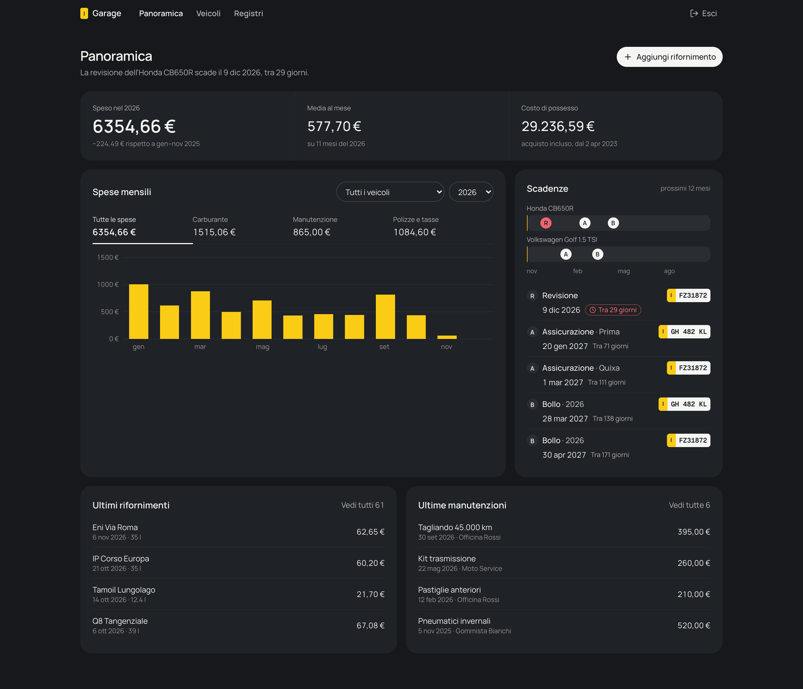
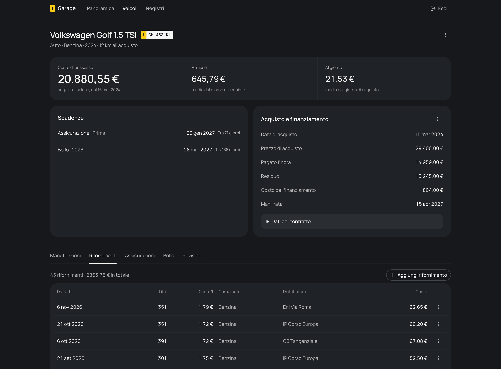

# Garage

Libretto digitale self-hosted per auto e moto: spese, scadenze e finanziamenti
in un unico posto. Pensato per un solo utente, in locale, protetto da passphrase.



## Funzionalità

- **Panoramica:** spesa dell'anno a confronto con l'anno precedente, grafico mensile per categoria, scadenze dei prossimi 12 mesi.
- **Veicoli:** scheda per ogni mezzo con costi, scadenze, acquisto e piano di finanziamento.
- **Registri:** rifornimenti, manutenzioni, assicurazioni, bollo e revisioni, con ricerca, ordinamento e paginazione.
- **Scadenze:** calcolate sull'ultima polizza, bollo e revisione; le righe precedenti restano come storico.
- **Backup:** dump e restore del database con un comando.



<sub>Screenshot con dati di esempio.</sub>

## Stack

Next.js 16 · TypeScript · PostgreSQL 17 · Drizzle ORM · TanStack Query · Tailwind CSS v4 · shadcn/ui · Docker

## Avvio rapido

Requisito: Docker con Compose.

```sh
git clone https://github.com/francescodelmonaco/garage-local.git
cd garage-local
cp .env.example .env   # imposta APP_PASSPHRASE e SESSION_SECRET
docker compose up -d --build
```

Apri http://localhost:3000. Le migrazioni partono da sole all'avvio; i dati
restano nel volume Docker `pgdata`.

## Configurazione

| Variabile | Uso |
| --- | --- |
| `APP_PASSPHRASE` | Passphrase di accesso |
| `SESSION_SECRET` | Firma del cookie di sessione (`openssl rand -hex 32`) |
| `SESSION_DAYS` | Durata della sessione in giorni (default 30) |
| `POSTGRES_PASSWORD` | Password del database |
| `APP_PORT` / `APP_BIND` | Porta e interfaccia esposte; `APP_BIND=0.0.0.0` per la rete locale |
| `DATABASE_URL` | Solo per `npm run dev` |

Dopo una modifica al `.env` esegui `docker compose up -d app`.

> L'app non è pensata per l'esposizione su internet: il login non ha rate limit.
> Dietro un reverse proxy HTTPS il cookie di sessione diventa `Secure` in automatico.

## Backup

```sh
npm run db:backup                           # crea backups/garage-AAAAMMGG-HHMMSS.dump
npm run db:restore -- backups/<file>.dump   # sostituisce i dati attuali
```

Gli script usano il container `db`: non serve `pg_dump` sull'host.

## Sviluppo

Requisito: Node.js 24+.

```sh
npm install
docker compose up -d db
npm run dev
npm run verify   # lint, tipi, test della logica, limite dimensione file
```

- [Sviluppo](docs/development.md): comandi, verifiche e convenzioni.
- [Architettura](docs/architecture.md): moduli e regole del dominio.
- [Indice della documentazione](docs/README.md), incluse le istruzioni per gli agenti AI.

## Licenza

[MIT](LICENSE) © 2026 Francesco Delmonaco
